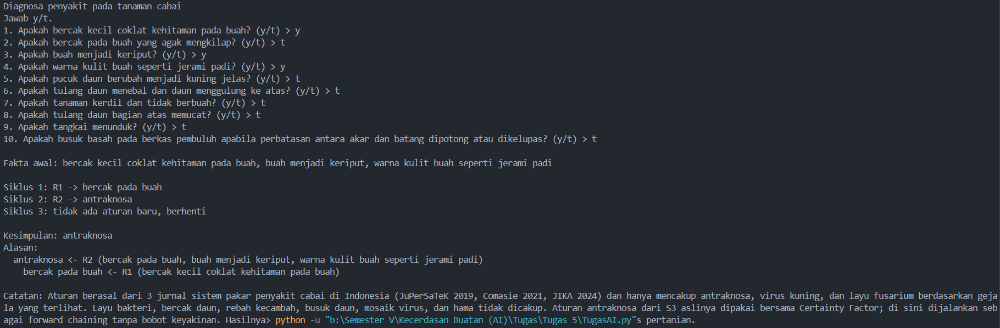
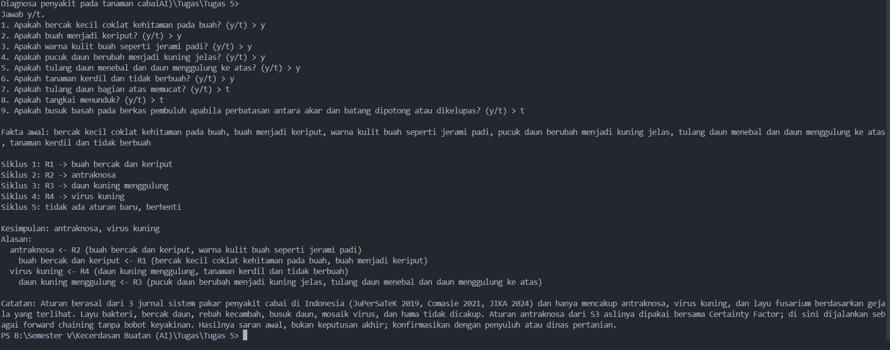
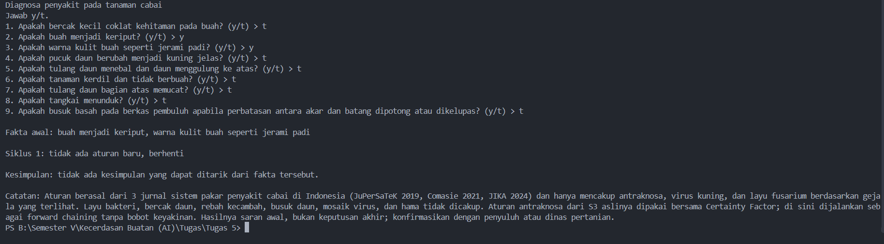

# ai-tugas5-F1D02410051
## Nama: I Gde Surya Laksana Diputra
## NIM : F1D02410051

## Topik dan cara menjalankan program
Topik: diagnosis awal penyakit pada tanaman cabai (antraknosa, virus kuning, dan layu fusarium). Program akan menanyakan gejala yang tampak pada tanaman, lalu program akan menyimpulkan penyakitnya beserta alasannya berdasarkan hasil jawaban dari pertanyaan tersebut.

## Daftar Sumber
| Kode | Judul | Penerbit | URL | Tanggal akses |
| :--- | :--- | :--- | :--- | :--- |
| S1 | Irnaldi, R. (2019). Sistem Pakar Diagnosa Penyakit Tanaman Cabai Menggunakan Metode Forward Chaining Berbasis Android | JuPerSaTeK: Jurnal Perencanaan, Sains, Teknologi, dan Komputer, Vol. 2 No. 1, hal. 165-174 (Universitas Islam Kuantan Singingi) | (https://ejournal.uniks.ac.id/index.php/JUPERSATEK/article/view/465) | [12 November 2026] |
| S2 | Gultom, H. H. & Yenni, Y. (2021). Sistem Pakar Mendiagnosa Penyakit Padatanaman Cabe Berbasis Web | Jurnal Comasie, Vol. 5 No. 3, hal. 25-35 (Universitas Putera Batam) | [http://ejournal.upbatam.ac.id/index.php/comasiejournal](http://ejournal.upbatam.ac.id/index.php/comasiejournal) | [12 November 2026] |
| S3 | Jamaludin, M. L., Bhakti, R. M. H. & Irawan, B. (2024). Expert System Hama Penyakit Cabai Menggunakan Metode Forward Chaining dan Certainty Factor Berbasis Website | JIKA (Jurnal of Informatics), Vol. 8 No. 3, hal. 318-325 (Universitas Muhammadiyah Tangerang) | [https://doi.org/10.31000/jika.v8i3.11847](https://doi.org/10.31000/jika.v8i3.11847) | [12 November 2026] |

## Tabel Aturan
| ID | Jika | Mode | Maka | Sumber |
| :--- | :--- | :--- | :--- | :--- |
| R1 | bercak kecil coklat kehitaman pada buah; buah menjadi keriput | dan | buah bercak dan keriput | S3 |
| R2 | buah bercak dan keriput; warna kulit buah seperti jerami padi | dan | antraknosa | S3 |
| R3 | pucuk daun berubah menjadi kuning jelas; tulang daun menebal dan daun menggulung ke atas | dan | daun kuning menggulung | S1 |
| R4 | daun kuning menggulung; tanaman kerdil dan tidak berbuah | dan | virus kuning | S1 |
| R5 | tulang daun bagian atas memucat; tangkai menunduk | dan | daun atas pucat dan tangkai menunduk | S2 |
| R6 | daun atas pucat dan tangkai menunduk; busuk basah pada berkas pembuluh apabila perbatasan antara akar dan batang dipotong atau dikelupas | dan | layu fusarium | S2 |

## Metode Forward Chaining
Program memulai dari fakta yang dijawab 'y' oleh pengguna, menjalankan aturan yang syaratnya terpenuhi (mode `dan` bila semua syarat ada di memori, mode `atau` bila salah satu ada), menambahkan hasilnya ke memori, dan mengulang sampai tidak ada aturan baru yang cocok. Satu aturan dijalankan pada tiap siklus, dan aturan yang hasilnya sudah ada di memori tidak akan dijalankan untuk kedua kalinya, sehingga program pasti akan berhenti. Setiap hasil dicatat berasal dari aturan mana, dan catatan itu digunakan untuk menampilkan alasan kesimpulan.

Saya memilih metode Forward Chaining karena dalam kasus ini, pengguna (petani) biasanya hanya mengetahui gejala yang tampak pada tanaman tetapi belum tahu penyakitnya, sehingga forward chaining lebih cocok dibandingkan backward chaining. Selain itu, satu kumpulan gejala dapat menghasilkan lebih dari satu kesimpulan sekaligus (misalnya virus kuning dan layu fusarium), dan Forward Chaining menemukan semuanya dalam satu kali jalan. Jurnal S1 dan S2 juga memakai forward chaining untuk kasus yang sama; S3 memakai forward chaining yang digabung dengan Certainty Factor, dan di sini hanya aturan IF-AND-nya yang saya pakai tanpa bobot keyakinan.

## Uji Kasus
### Kasus 1
Jawaban 'y' pada pertanyaan nomor 1, 2, dan 3 (gejala antraknosa). Hasil: antraknosa.

### Kasus 2
Jawaban 'y' pada pertanyaan nomor 4 sampai 9 (gejala virus kuning dan layu fusarium). Hasil: dua kesimpulan sekaligus.

### Kasus 3
Jawaban 'y' hanya pada pertanyaan nomor 2 dan 3 (buah keriput dan kulit buah seperti jerami, tanpa bercak pada buah). Hasil: tidak ada kesimpulan, karena syarat R1 belum terpenuhi.

## Batas Keberlakuan
Pengetahuan dalam sistem ini berasal dari tiga artikel jurnal ilmiah (Irnaldi, 2019; Gultom dan Yenni, 2021; Jamaludin dkk., 2024), jadi aturan mencerminkan temuan para penulis tersebut, bukan pakar yang diwawancarai langsung. Sistem hanya berlaku untuk diagnosis awal tanaman cabai di Indonesia berdasarkan gejala yang terlihat, dan hanya mencakup antraknosa, virus kuning, dan layu fusarium; layu bakteri, bercak daun, rebah kecambah, busuk daun, mosaik virus, hama, serta jenis cabai dan iklim tidak dibedakan. Hasilnya adalah saran awal, bukan keputusan akhir, dan perlu dikonfirmasi dengan penyuluh pertanian atau dinas pertanian setempat. Pernyataan ini juga ditampilkan oleh program pada baris "Catatan" di akhir keluaran.

## Penggunaan AI
Saya menggunakan AI untuk membantu menyusun kode untuk algoritma forward chaining, melakukan brainstorming untuk pemilihan topik dari AI, dan menggunakan AI untuk membantu memperbaiki error yang terjadi di kode.
